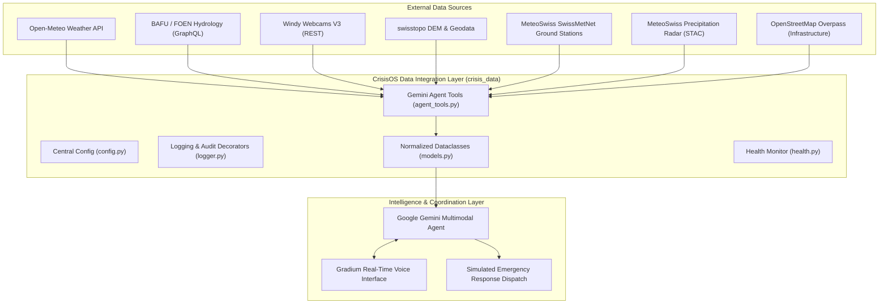

# CrisisOS Switzerland — Architecture & Feature Design Document

This document records the system architecture, component breakdown, module responsibilities, and implemented features for **CrisisOS Switzerland**.

---

## 1. System Overview & Vision

**CrisisOS** is an autonomous, multimodal disaster intelligence and emergency coordination platform focused on Switzerland, initially targeting flood risk management along the **Limmat** and **Sihl** rivers in the Canton of Zurich.

The system connects live environmental sensors (river levels, discharge, rainfall, weather station networks), geographical models (swisstopo DEM, flood zones), visual confirmation (Windy webcams), and critical infrastructure databases (OSM hospitals, bridges, fire stations) into a cohesive agentic pipeline powered by **Google Gemini** and voice-enabled by **Gradium**.

---

## 2. Centralized Configuration & Standards

All system constants, endpoint URLs, bounding coordinates, model names, and logging parameters reside centrally in [`crisis_data/config.py`](file:///Users/martinmaranon2/hackathon-tech-europe/crisis_data/config.py):
- **Model identifiers**: e.g., `gemini-2.5-flash`, `gemini-2.5-pro`.
- **Zurich bounding box & default stations**: Sihl (2176), Limmat (2099), SMA Fluntern.
- **Timeouts & Caching TTL**: 15s default HTTP timeout, 15-minute TTL for OSM queries.
- **Authentication**: Ingested strictly via `.env` / environment variables (`WINDY_API_KEY`, `GEMINI_API_KEY`).

Every function execution is logged at `INFO` level using `@log_function_call` in [`crisis_data/logger.py`](file:///Users/martinmaranon2/hackathon-tech-europe/crisis_data/logger.py), sanitizing large binary payloads (such as base64 images) to keep audit logs clean and secure.

---

## 3. Implemented Modules & Feature Breakdown

| Feature | Source File | Description & Use Cases |
| :--- | :--- | :--- |
| **System Guidelines** | [`AGENTS.md`](file:///Users/martinmaranon2/hackathon-tech-europe/AGENTS.md) | Coding and documenting guidelines, modularity requirements, and logging rules. |
| **Central Configuration** | [`crisis_data/config.py`](file:///Users/martinmaranon2/hackathon-tech-europe/crisis_data/config.py) | Centralized storage for model names, endpoints, Zurich coordinates, and timeouts. |
| **Audit & Logging** | [`crisis_data/logger.py`](file:///Users/martinmaranon2/hackathon-tech-europe/crisis_data/logger.py) | Function call logger (`@log_function_call`) and GenAI call logger with payload sanitization. |
| **Normalized Data Schemas** | [`crisis_data/models.py`](file:///Users/martinmaranon2/hackathon-tech-europe/crisis_data/models.py) | Pydantic / dataclass schemas (`NormalizedObservation`, `CameraMetadata`, `InfrastructureItem`, `DataSourceHealth`). |
| **Weather Forecasts** | [`crisis_data/open_meteo.py`](file:///Users/martinmaranon2/hackathon-tech-europe/crisis_data/open_meteo.py) | Priority 1: Current weather, precipitation, 24h rain totals, and hourly outlooks from Open-Meteo. |
| **Hydrological Monitoring** | [`crisis_data/bafu_hydro.py`](file:///Users/martinmaranon2/hackathon-tech-europe/crisis_data/bafu_hydro.py) | Priority 2: Real-time river water levels ($W$), discharge rate ($Q$), and temperatures from BAFU GraphQL. |
| **Visual Webcam Intelligence** | [`crisis_data/windy_webcams.py`](file:///Users/martinmaranon2/hackathon-tech-europe/crisis_data/windy_webcams.py) | Priority 3: Camera discovery near Zurich bridges/rivers and multimodal image download for Gemini visual verification. |
| **Geospatial & Elevation** | [`crisis_data/swisstopo.py`](file:///Users/martinmaranon2/hackathon-tech-europe/crisis_data/swisstopo.py) | Priority 4: Ground elevation from swisstopo Height API, WGS84 $\leftrightarrow$ LV95 coordinate conversions, Geoportal links. |
| **Ground Station Observations** | [`crisis_data/meteoswiss_smn.py`](file:///Users/martinmaranon2/hackathon-tech-europe/crisis_data/meteoswiss_smn.py) | Priority 5: High-precision 10-minute automated ground weather observations from SwissMetNet (`sma`, `reh`, `klo`). |
| **Precipitation Radar** | [`crisis_data/meteoswiss_radar.py`](file:///Users/martinmaranon2/hackathon-tech-europe/crisis_data/meteoswiss_radar.py) | Priority 6: STAC discovery for national 5-minute radar composites across Switzerland. |
| **Critical Infrastructure** | [`crisis_data/osm_infrastructure.py`](file:///Users/martinmaranon2/hackathon-tech-europe/crisis_data/osm_infrastructure.py) | Priority 7: Identification of nearby hospitals, fire stations, and vulnerable bridges from OpenStreetMap Overpass. |
| **Data Health Monitor** | [`crisis_data/health.py`](file:///Users/martinmaranon2/hackathon-tech-europe/crisis_data/health.py) | Dynamic diagnostics across all external data sources, producing markdown health tables. |
| **Gemini Tool Interface** | [`crisis_data/agent_tools.py`](file:///Users/martinmaranon2/hackathon-tech-europe/crisis_data/agent_tools.py) | Standalone callable functions with standard typed signatures ready for Gemini Tool declarations. |
| **Integration Test Suite** | [`test_integrations.py`](file:///Users/martinmaranon2/hackathon-tech-europe/test_integrations.py) | End-to-end smoke test runner verifying connectivity, real data retrieval, and data freshness across all 7 sources. |

---

## 4. Agent Tools Integration Contract

The data layer exposes the following standardized functions for Gemini reasoning:

1. `get_weather(latitude: float = 47.3769, longitude: float = 8.5417) -> Dict[str, Any]`
2. `get_river_stations() -> List[Dict[str, Any]]`
3. `get_river_measurements(station_no: str = "2176") -> Dict[str, Any]`
4. `get_nearby_webcams(latitude: float = 47.3769, longitude: float = 8.5417, radius_km: float = 15.0) -> List[Dict[str, Any]]`
5. `get_webcam_image(camera_id: str, image_url: Optional[str] = None) -> Dict[str, Any]` (returns base64 image payload)
6. `get_weather_stations(radius_km: float = 30.0) -> List[Dict[str, Any]]`
7. `get_precipitation_radar(limit: int = 5) -> Dict[str, Any]`
8. `get_nearby_infrastructure(latitude: float = 47.3769, longitude: float = 8.5417, radius_km: float = 3.0) -> List[Dict[str, Any]]`
9. `get_data_source_health() -> List[Dict[str, Any]]`

---

## 5. Next Planned Milestones

1. **Gemini Agent Multimodal Orchestration**:
   - Implement Gemini 2.5 Flash / Pro system prompt incorporating tools from [`crisis_data.agent_tools`](file:///Users/martinmaranon2/hackathon-tech-europe/crisis_data/agent_tools.py).
   - Multimodal prompt flow: Compare river discharge threshold warnings with latest webcam imagery.
2. **Gradium Voice Interface**:
   - Bind audio input/output stream to the agent decision loop for hands-free commander queries.
3. **Simulated Response Dispatch**:
   - Compute risk-weighted routing to endangered bridges and dispatch simulated civil defense units.
